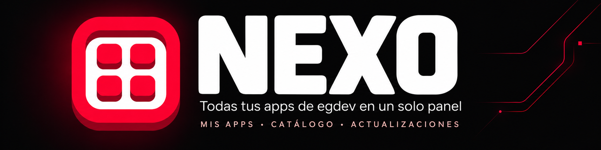
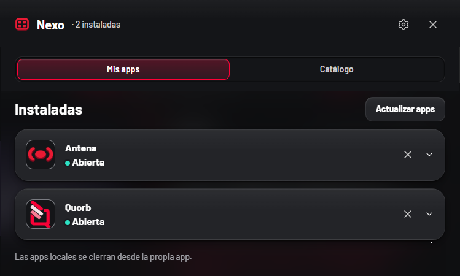

<!-- egdev:lang:start -->
<p align="right">
  <a href="./README.md"></a>
  
</p>
<!-- egdev:lang:end -->

<!-- egdev:header:start -->


<div align="center">

[](https://github.com/egdev6/nexo/releases)
[](https://github.com/egdev6/nexo/stargazers)
[](https://github.com/egdev6/nexo/issues)
[](./LICENSE)

</div>
<!-- egdev:header:end -->

# Nexo

Nexo reúne aplicaciones compatibles en un único hub.

## Qué es

Nexo es un hub de bandeja para Windows que permite acceder a aplicaciones compatibles y sus acciones desde un panel anclado a la derecha. También muestra apps oficiales de un catálogo público y permite gestionar apps locales.

El panel permanece abierto mientras trabajáis en otras ventanas. Utiliza la bandeja de Windows para acceder rápidamente y conserva vuestros ajustes entre sesiones.

<p align="center"></p>

<!-- egdev:stack:start -->
## Stack

<div align="center">
<a href="https://github.com/Gentleman-Programming/gentle-ai">
  
</a>
</div>

<div align="center">


</div>
<!-- egdev:stack:end -->

## Inicio rápido

### Instalar

En Windows 10 u 11, descargad `Nexo_<version>_x64-setup.exe` desde [Releases](https://github.com/egdev6/nexo/releases) y ejecutadlo. La instalación es por usuario y no requiere permisos de administrador. El instalador no tiene firma de código de Windows, por lo que SmartScreen puede pedir confirmación. Desde la 0.2.0, Nexo busca versiones nuevas al arrancar y desde **Ajustes › Acerca de**, y las instala cuando lo confirmáis; las versiones anteriores se actualizan instalando la nueva encima.

El repositorio es privado, por lo que necesitáis permiso para acceder a la release.

### Desarrollar

Instalad Rust estable y Node.js 22.12 o superior dentro de la rama 22.x, o Node.js 24 o superior. Vite necesita Node.js 22.12+ y Vitest no es compatible con Node.js 23. Las herramientas del design system para agentes requieren Node.js 24.x. Para ejecutar el hub hacen falta Windows y WebView2. Mientras el repositorio sea privado, necesitáis permiso para clonarlo.

```sh
git clone https://github.com/egdev6/nexo.git
cd nexo
cd apps/hub
npm ci
npm test
npm run build
npm run app:dev
```

Compilad el frontend antes de ejecutar las comprobaciones de Rust, ya que el hub lo incorpora. Consultad [Contribuir](./CONTRIBUTING.md) para el flujo de trabajo y las comprobaciones de Windows.

## Scripts

Desde `apps/hub`:

| Comando | Función |
| --- | --- |
| `npm run dev` | Iniciar el servidor de desarrollo del frontend. |
| `npm test` | Ejecutar los tests del frontend. |
| `npm run ds:doctor` | Comprobar la instalación del design system y ejecutar su protección (elementos sin componente, selectores internos, lista de excepciones). |
| `npm run build` | Comprobar TypeScript y compilar el frontend. |
| `npm run app:dev` | Ejecutar la aplicación de escritorio en desarrollo. |

Desde la raíz del repositorio, tras compilar el frontend:

```sh
cargo fmt --all -- --check
cargo clippy --workspace --all-targets -- -D warnings
cargo test --workspace
cargo build --workspace
```

`scripts/check.sh --windows` ejecuta la verificación local, incluidos los tests y Clippy nativos de Windows desde WSL; consultad [Contribuir](./CONTRIBUTING.md) para los requisitos. CI ejecuta las mismas comprobaciones en Windows en cada pull request.

## Arquitectura

- `apps/hub/` contiene el hub Tauri y React; el protocolo compartido (`nexo-protocol`) y el [cliente de bandeja de Windows](https://github.com/egdev6/tauri-plugin-nexo/blob/v0.1.1/crates/tauri-plugin-nexo/README.md) vienen del repositorio público [egdev6/tauri-plugin-nexo](https://github.com/egdev6/tauri-plugin-nexo); `crates/nexo-catalog/` valida los datos del catálogo.
- Un clic izquierdo en el icono de la bandeja muestra u oculta el panel. El botón X y Escape también lo ocultan; con clic derecho y **Salir** cerráis la aplicación. Una segunda ejecución muestra el panel existente. El panel tiene tamaño fijo, permanece por encima de las demás ventanas, ocupa la altura del área de trabajo, cubre su borde derecho y se desplaza cuando hace falta. Sigue abierto al perder el foco; las pestañas admiten flechas, Inicio y Fin.
- El hub sirve el protocolo IPC para apps que usan `tauri-plugin-nexo`, cuyas acciones aparecen en su menú de bandeja. Para apps oficiales instaladas sin el plugin, detecta el proceso del ejecutable correspondiente e indica si está abierto, detenido o si su estado es desconocido. La solicitud de cierre equivale al botón X de la app, nunca fuerza la terminación y avisa si la app sigue abierta, por ejemplo en su bandeja. Las apps locales se cierran desde la propia aplicación.
- Los ajustes se guardan en el directorio de configuración de la aplicación. **Ocultar apps locales** está desactivado por defecto; al activarlo se oculta su sección de Mis apps sin afectar a su gestión desde Ajustes.
- El [catálogo oficial](https://github.com/egdev6/nexo-catalog) y sus novedades se sirven mediante GitHub Pages y se guardan en caché local. Los cambios del catálogo pueden llegar a los hubs instalados sin publicar una versión de Nexo; desarrollo y tests usan datos de ejemplo. Novedades se abre al mostrar el hub solo si hay noticias oficiales sin ver de los últimos 30 días y está activado **Mostrar novedades al abrir**.
- El hub usa paquetes vendorizados del design system EGDEV y expone su servidor MCP a los agentes. Consultad el [ADR 0001](./docs/decisions/0001-adopt-egdev-design-system.md) para las versiones fijadas, las reglas y el procedimiento de actualización.

## Contribuir

Empezad con una issue, trabajad en una rama y abrid una pull request. Ejecutad las comprobaciones locales antes de enviarla. Consultad [CONTRIBUTING.md](./CONTRIBUTING.md) para el proceso completo y las reglas del design system.

## Recursos

- [Repositorio del catálogo oficial](https://github.com/egdev6/nexo-catalog)
- [Decisión del design system (ADR 0001)](./docs/decisions/0001-adopt-egdev-design-system.md)
- [Formato y carga del catálogo](./docs/catalog.md)
- [Protocolo IPC](https://github.com/egdev6/tauri-plugin-nexo/blob/v0.1.1/docs/protocol.md)
- [Resolución de problemas de arranque](./docs/troubleshooting.md)
- [Guía del plugin Tauri](https://github.com/egdev6/tauri-plugin-nexo/blob/v0.1.1/crates/tauri-plugin-nexo/README.md)

## Licencia

Nexo está disponible bajo la [licencia MIT](./LICENSE).

<!-- egdev:contact:start -->
## Contacto

<div align="center">

[](https://egdev.es)
[](https://www.youtube.com/@egdev6)
[](https://twitch.tv/egdev6)
[](https://x.com/egdev66)
[](https://www.linkedin.com/in/egdev6/)
[](https://www.instagram.com/egdev6/)
[](https://github.com/egdev6)

[](mailto:egdev6@gmail.com)

</div>
<!-- egdev:contact:end -->

<!-- egdev:footer:start -->
---

<div align="center">

**⭐ Si este proyecto te resulta útil, considera darle una estrella en GitHub ⭐**

</div>
<!-- egdev:footer:end -->
