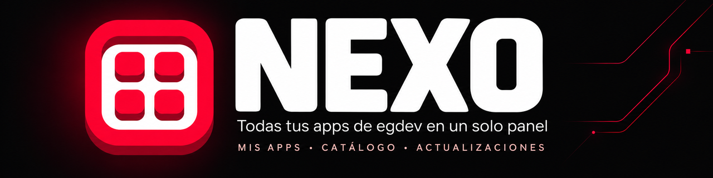
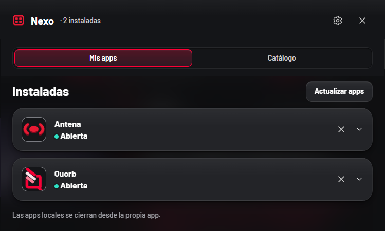

<!-- egdev:lang:start -->
<p align="right">
  
  <a href="./README.es.md"></a>
</p>
<!-- egdev:lang:end -->

<!-- egdev:header:start -->


<div align="center">

[](https://github.com/egdev6/nexo/releases)
[](https://github.com/egdev6/nexo/stargazers)
[](https://github.com/egdev6/nexo/issues)
[](./LICENSE)

</div>
<!-- egdev:header:end -->

# Nexo

Nexo brings compatible apps together in a single hub.

## What is it

Nexo is a Windows tray hub for accessing compatible apps and their actions from a right-anchored panel. It also shows official apps from a public catalog and lets you manage local apps.

The panel stays open while you work elsewhere. It uses the Windows tray for quick access and keeps your settings between sessions.

<p align="center"></p>

<!-- egdev:stack:start -->
## Stack

<div align="center">
<a href="https://github.com/Gentleman-Programming/gentle-ai">
  
</a>
</div>

<div align="center">


</div>
<!-- egdev:stack:end -->

## Quick start

### Install

On Windows 10 or 11, download `Nexo_<version>_x64-setup.exe` from [Releases](https://github.com/egdev6/nexo/releases) and run it. Installation is per user and does not require administrator rights. The installer is not Windows code-signed, so SmartScreen may ask for confirmation. From 0.2.0 on, Nexo checks for new versions at startup and from **Settings › About**, and installs them after you confirm; earlier versions must be updated by installing the new one over them.

The repository is private, so access to the release requires permission.

### Develop

Install Rust stable and Node.js 22.12 or newer within the 22.x line, or Node.js 24 or newer. Vite requires Node.js 22.12+, and Vitest does not support Node.js 23. The design-system agent tools require Node.js 24.x. Running the hub requires Windows and WebView2. Clone access requires permission while the repository is private.

```sh
git clone https://github.com/egdev6/nexo.git
cd nexo
cd apps/hub
npm ci
npm test
npm run build
npm run app:dev
```

Build the frontend before running Rust checks, because the hub embeds it. See [Contributing](./CONTRIBUTING.md) for the workflow and Windows checks.

## Scripts

From `apps/hub`:

| Command | Purpose |
| --- | --- |
| `npm run dev` | Start the frontend development server. |
| `npm test` | Run frontend tests. |
| `npm run ds:doctor` | Check the design-system install and run its guard (raw elements, internal selectors, allowlist). |
| `npm run build` | Check TypeScript and build the frontend. |
| `npm run app:dev` | Run the desktop app in development. |

From the repository root, after building the frontend:

```sh
cargo fmt --all -- --check
cargo clippy --workspace --all-targets -- -D warnings
cargo test --workspace
cargo build --workspace
```

`scripts/check.sh --windows` runs the local verification, including native Windows tests and Clippy from WSL; see [Contributing](./CONTRIBUTING.md) for prerequisites. CI runs the same checks on Windows for every pull request.

These workspace checks cover the hub and catalog. The shared protocol and tray plugin live in the public repository [egdev6/tauri-plugin-nexo](https://github.com/egdev6/tauri-plugin-nexo), pinned by the hub at `v0.1.1`, and are tested by its CI.

## Architecture

- `apps/hub/` contains the Tauri and React hub; the shared protocol (`nexo-protocol`) and the [Windows tray client](https://github.com/egdev6/tauri-plugin-nexo/blob/v0.1.1/crates/tauri-plugin-nexo/README.md) come from the public repository [egdev6/tauri-plugin-nexo](https://github.com/egdev6/tauri-plugin-nexo); `crates/nexo-catalog/` validates catalog data.
- Left-click the tray icon to show or hide the flyout. Its X button and Escape also hide it; right-click and choose **Salir** to quit. A second launch shows the existing panel. The fixed-size, always-on-top flyout fills the work area's height, covers its right edge and scrolls when needed. It stays open on focus loss; tabs support arrow keys, Home and End.
- The hub serves the IPC protocol for apps using `tauri-plugin-nexo`, whose actions appear in its tray menu. For installed official apps without the plugin, it detects the matching executable's process and reports whether it is open, stopped or unknown. A close request behaves like the app's X button, never forces termination and warns if the app remains open, for example in its tray. Close local apps from within the app.
- Settings persist in the app configuration directory. **Hide local apps** is off by default; enabling it hides their section in My apps without affecting their management in Settings.
- The [official catalog](https://github.com/egdev6/nexo-catalog) and its news are served by GitHub Pages and cached locally. Catalog changes can reach installed hubs without a Nexo release; development and tests use sample data. Novedades opens when the hub is shown only if there is unseen official news from the last 30 days and **Mostrar novedades al abrir** is enabled.
- The hub uses vendored EGDEV design-system packages and exposes their MCP server to agents. See [ADR 0001](./docs/decisions/0001-adopt-egdev-design-system.md) for the pinned packages, rules and upgrade procedure.

## Contributing

Start with an issue, then work on a branch and open a pull request. Run the local checks before submitting. See [CONTRIBUTING.md](./CONTRIBUTING.md) for the full process and design-system rules.

## Resources

- [Official catalog repository](https://github.com/egdev6/nexo-catalog)
- [Design-system decision (ADR 0001)](./docs/decisions/0001-adopt-egdev-design-system.md)
- [Catalog format and loading](./docs/catalog.md)
- [IPC protocol](https://github.com/egdev6/tauri-plugin-nexo/blob/v0.1.1/docs/protocol.md)
- [Startup troubleshooting](./docs/troubleshooting.md)
- [Tauri plugin guide](https://github.com/egdev6/tauri-plugin-nexo/blob/v0.1.1/crates/tauri-plugin-nexo/README.md)

## License

Nexo is available under the [MIT License](./LICENSE).

<!-- egdev:contact:start -->
## Contact

<div align="center">

[](https://egdev.es)
[](https://www.youtube.com/@egdev6)
[](https://twitch.tv/egdev6)
[](https://x.com/egdev66)
[](https://www.linkedin.com/in/egdev6/)
[](https://www.instagram.com/egdev6/)
[](https://github.com/egdev6)

[](mailto:egdev6@gmail.com)

</div>
<!-- egdev:contact:end -->

<!-- egdev:footer:start -->
---

<div align="center">

**⭐ If you find this project useful, consider giving it a star on GitHub ⭐**

</div>
<!-- egdev:footer:end -->
